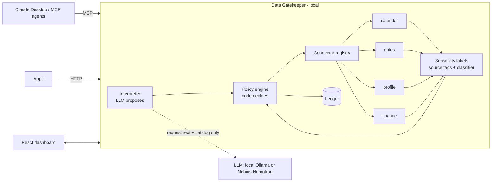

# Data Gatekeeper

**Your AI agents get answers, not your data.**

When an agent such as Claude needs personal data (calendar, notes, finances, profile), it asks
the Data Gatekeeper instead of holding your accounts. The gatekeeper works out what the agent
actually needs, returns the least revealing answer, enforces your rules, and asks you only
when unsure.

```
Agent: "Give me the user's whole calendar so I can plan a trip"
Gatekeeper → calendar.free_slots(November, ≥72h)
Agent receives: [{"start": "2026-11-19T00:00", "end": "2026-11-23T09:00"}]  ← no titles, no attendees
```

## Why

Today agents get broad OAuth scopes ("read all calendar") because there is nothing finer.
Approving every request leads to approval fatigue. The Data Gatekeeper:

- **Narrows** each request to the lowest-exposure operation that serves the task.
- **Enforces** your rules deterministically (a deny always wins).
- **Asks** only for new or uncertain cases. Your "Always / Never" answer becomes a rule.
- **Records** what crossed the boundary as item IDs and categories, never the content.

## Architecture



**The model proposes; deterministic code decides.** The LLM sees only the agent's request and
the operation catalog, never your data. Its choice is validated against the catalog, then
grant-checked and policy-filtered like any other request.

### Request lifecycle
1. **Grant check**: Is the agent connected, unexpired, unrevoked, and allowed this operation?
2. **Connector operation**: Returns items, each labelled with sensitivity categories.
3. **Labelling**: Source tags (e.g. a `finance/` folder) plus a content classifier. Content
   can only *add* labels, never remove them.
4. **Policy** per category: deny > your rules > template > ask (fail closed).
5. **Response**: Allowed items are returned. Denied items are withheld silently. "Ask" items
   are withheld and raise one approval per agent and category.
6. **Ledger**: Records the outcome.

### Sensitivity categories and templates
| Category | Strict | Balanced (default) | Open |
|---|---|---|---|
| financial | deny | deny | ask |
| credentials | deny | deny | deny |
| health | deny | ask | ask |
| location | ask | ask | allow |
| private_notes | deny | ask | allow |
| people | ask | allow | allow |
| work | ask | allow | allow |
| general | allow | allow | allow |

### Connectors (pluggable data sources)
Each connector exposes typed operations with an **exposure level**: 1 = derived answer,
2 = selected fields, 3 = raw records. Agents cannot "read everything", only call these.

| Source | Operations |
|---|---|
| `calendar` | `free_slots` (1), `events` (3) |
| `notes` | `count` (1), `search` → title + excerpt (2), `read` (3) |
| `profile` | `preferences` (2), `field` (2) |
| `finance` | `spending_summary` (1), `transactions` (3) |

**Adding a source**: Subclass `Connector` in `gatekeeper/connectors/`, return labelled `Item`s,
and register it in `connectors/__init__.py`. The policy engine, MCP server, API and dashboard
pick it up automatically. See `connectors/notes.py` (about 100 lines).

All sample data in `data/` is synthetic.

## Quick start

Requires Python 3.11+, Node 20+, and optionally [Ollama](https://ollama.com).

```bash
python3 -m venv .venv && .venv/bin/pip install -r requirements.txt
cp .env.example .env                       # INTERPRETER=mock|local|nebius
(cd dashboard && npm install)

# optional local model
ollama pull qwen3:8b

.venv/bin/uvicorn gatekeeper.api:app --port 8000      # API
(cd dashboard && npm run dev)                         # dashboard → http://localhost:5173
.venv/bin/python -m pytest -q                         # tests
```

### Model backends (`.env`)
| `INTERPRETER` | Model | Notes |
|---|---|---|
| `mock` | keyword heuristic | offline, deterministic |
| `local` | Ollama `qwen3:8b` | open-source, on-device |
| `nebius` | `nvidia/Nemotron-3_5-Lightning` via Nebius Token Factory | set `NEBIUS_API_KEY` |

### Claude Desktop
Add to `~/Library/Application Support/Claude/claude_desktop_config.json`:
```json
{
  "mcpServers": {
    "privacy-gatekeeper": {
      "command": "/ABSOLUTE/PATH/PrivacyPlugin/.venv/bin/python",
      "args": ["-m", "gatekeeper.mcp_server"],
      "cwd": "/ABSOLUTE/PATH/PrivacyPlugin",
      "env": { "PYTHONPATH": "/ABSOLUTE/PATH/PrivacyPlugin", "GATEKEEPER_AGENT": "claude-desktop" }
    }
  }
}
```
Quit Claude Desktop with Cmd+Q and reopen it. It gets three tools: `request_data`, `list_sources`
and `query`. Turn off any other connectors Claude has to the same data, so the gatekeeper is the only path.

## Project layout
```
gatekeeper/
  connectors/   base.py (Connector, Registry), calendar, notes, profile, finance
  core.py       Gatekeeper: grants → operation → policy → ledger
  policy.py     templates + deterministic rule engine
  classifier.py content-based sensitivity labels
  interpreter.py free text → typed operation (mock / Ollama / Nebius)
  store.py      SQLite: rules, grants, escalations, ledger
  mcp_server.py MCP tools for Claude Desktop
  api.py        FastAPI for the dashboard and HTTP apps
  admin.py      CLI fallback
dashboard/      React + Vite
data/           synthetic sample data
scripts/        seed_demo.py, try_interpreter.py, verify_google.py
tests/
```

## Honest limits
- **Only protects traffic routed through it.** If an agent has its own credentials, the
  gatekeeper cannot see them.
- **Revocation stops future access.** It cannot take back data already delivered.
- **The classifier is keyword-based** and can miss things. Uncertain categories default to "ask",
  and source tags carry most of the weight.
- **Derived answers can still leak patterns** over many queries (e.g. a routine from free/busy data).
- **Nebius mode sends the request text** (not your data) to the cloud.

See [DEMO.md](DEMO.md) for the 3-minute demo script.
